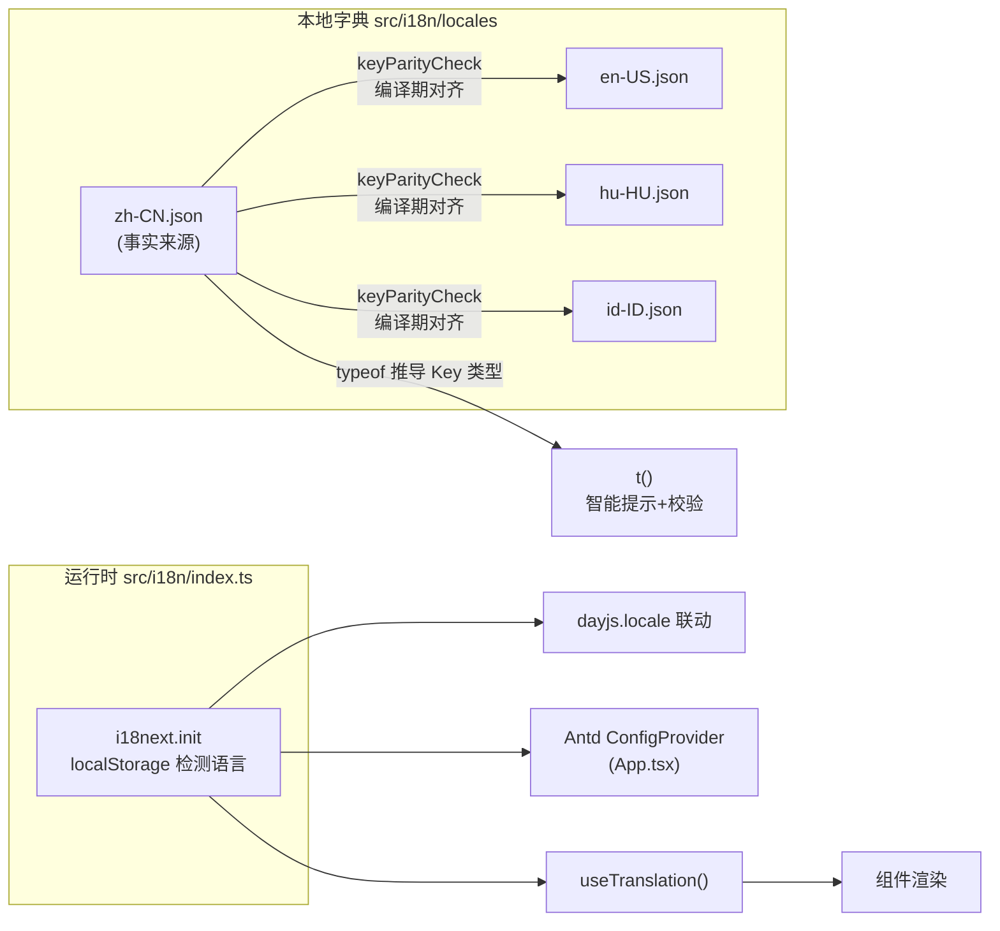

# i18n 国际化文档集

本项目基于 i18next + react-i18next 实现界面国际化，支持四种语言：zh-CN / en-US / hu-HU / id-ID。字典为本地 JSON 静态打包，无网络请求，首屏同步可用。

本文档集自包含全部核心代码，可脱离仓库独立阅读。代码摘自仓库快照（2026-11），源码路径均以 `src/` 为根标注；若与最新源码不一致，以源码为准。

## 文档导航

| 文档 | 内容 | 什么时候读 |
|---|---|---|
| [01-architecture.md](./01-architecture.md) | 架构设计、前后端职责边界、文件清单、初始化与切换链路 | 接手前了解整体设计 |
| [02-usage-guide.md](./02-usage-guide.md) | 任务指南：显示翻译、新增 Key、插值、翻译枚举、新增语言 | 日常开发按任务查阅 |
| [03-dictionary-guide.md](./03-dictionary-guide.md) | Key 命名规范、命名空间划分、四语同步、翻译质量约定 | 维护字典时 |
| [04-type-system.md](./04-type-system.md) | t() 智能提示、tEnum 全覆盖校验的类型实现与报错解读 | 遇到类型报错或想深入原理 |
| [05-troubleshooting.md](./05-troubleshooting.md) | 常见故障：页面显示 Key、文案不随语言切换、IDE 误报 | 排查问题 |

## 三分钟上手

在组件里显示一条翻译只需三步：

```tsx
import { useTranslation } from 'react-i18next';

const MyComponent: React.FC = () => {
  const { t } = useTranslation();
  return <Button>{t('common.button.submit')}</Button>;
};
```

Key 拼错或不存在时 TypeScript 直接报错，无需运行时验证。若需要的 Key 尚未存在，先在 `src/i18n/locales/` 的四份 JSON 中同时添加（zh-CN 是事实来源，其余三份必须同步），流程见[字典维护规范](./03-dictionary-guide.md)。

## 架构一页图



## 核心约定

以下五条贯穿整个实现，任何一条被破坏都会产生编译错误或界面异常：

1. UI 文案一律通过 `t()` 获取，代码中不写死任何语言的文字（注释、console.log 除外）
2. zh-CN.json 是字典唯一事实来源，修改后必须同步其余三份，keyParityCheck 在编译期强制对齐
3. 前端自有枚举用 `tEnum` 翻译，字典统一挂在 `enum.*` 命名空间下
4. 后端业务数据已由后端返回翻译后文本，前端原样展示，不做任何翻译处理
5. 模块顶层禁止调用 `t()`，需要随语言切换更新的组件必须通过 `useTranslation` 订阅
6. 语言是设备端进程级状态：下拉选项来自 `GET /api/app/Common/Sensor/Language`，切换走 POST 接口，SignalR `LanguageChanged` 广播同步所有客户端（详见 [01-architecture.md](./01-architecture.md#语言切换链路)）

## 依赖

| 包 | 用途 |
|---|---|
| i18next | 核心库：字典加载、语言检测、翻译查找 |
| react-i18next | React 绑定：`useTranslation` Hook、类型增强入口 |
| i18next-browser-languagedetector | 浏览器语言检测与 localStorage 持久化 |
| dayjs（项目原有） | 日期本地化，随语言切换联动 |
